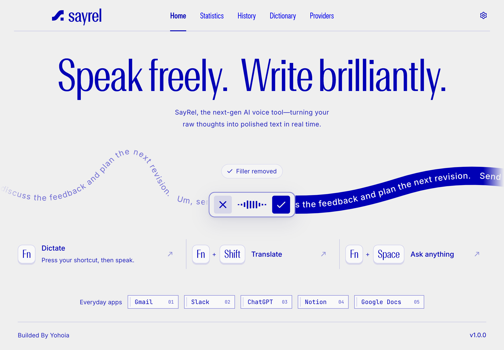
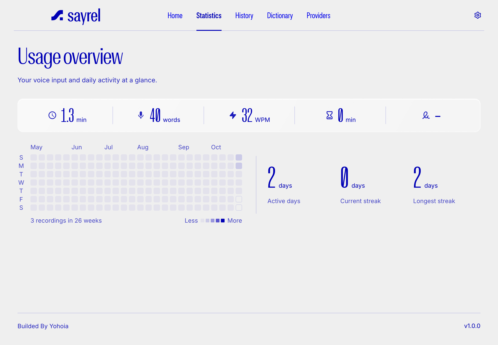
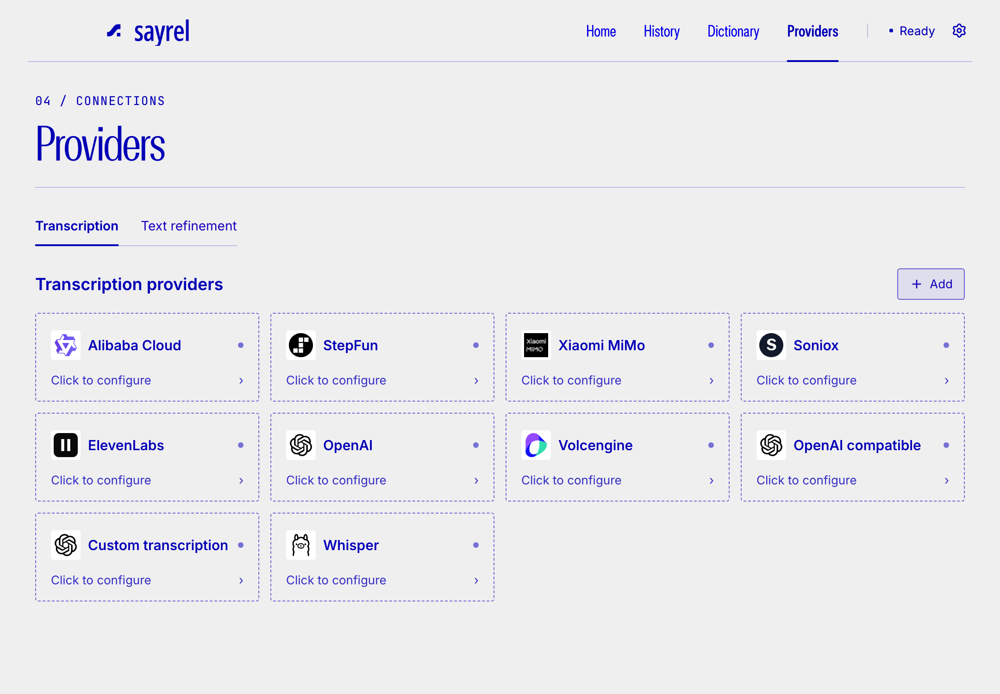

# Sayrel

**Speak more. Type less.** — AI-powered voice typing

Sayrel 是一个面向 macOS 的语音输入与写作助手。你在当前聚焦的输入位置用 Fn 系列快捷键说话，Sayrel 负责录音、调用你配置的模型服务，并把转写、润写、翻译或问答结果放回当前工作流。



## 它能做什么

| 快捷键 | 动作 |
| --- | --- |
| `Fn` | 开始/结束口述，生成转写并用润写模型整理成可插入的文本 |
| `Fn + Shift` | 口述内容并翻译到目标语言 |
| `Fn + Space` | 提问并获得回答卡 |

除快捷键输入外，Sayrel 还提供：

- **历史记录**：筛选、分页、下载录音、重试和查看回答。
- **词典**：维护专有名词，减少重复口述纠错；支持 CSV 导入。
- **服务商**：分别配置语音转写与文本润写模型，可验证连接、发现模型并设置默认项。
- **统计页**：查看语音时长、输入字数等五项输入指标、最近26周的使用热力图，以及基于保留历史的活跃天数和连续天数。

> 界面截图来自离线验收 fixture；真实转写、翻译与问答需要你自己的可用模型服务配置。应用无需登录，服务商密钥由你自行配置。



## 快速开始

需要 macOS、Node.js 22+、npm 10+ 和 Xcode Command Line Tools。

```bash
npm ci
npm run native
npm run dev
```

首次启动按引导授予麦克风和辅助功能权限，然后在顶部导航打开「Providers」，分别配置转写与润写模型。默认快捷键可在设置中修改。



界面默认英文，可在设置中切换语言；简体中文同步覆盖主页面与独立窗口。使用 Sayrel 品牌素材、灰白底与 Hermes 蓝字；本地 Rules 字体用于展示标题和导航，Inter 用于正文，JetBrains Mono 用于快捷键。字体来源、Logo 对应位置及授权边界见 [品牌素材文档](docs/brand-assets.md)。当前视觉规则见 [设计规范](DESIGN.md)，全应用截图见 [改版记录](docs/design-exploration/blueprint-system-20261021/README.md)。

## 工作方式

```text
快捷键
  ↓
Swift 全局监听 + Electron 录音会话
  ↓
语音转写模型 → 文本润写模型
  ↓
插入当前输入位置 / 显示回答卡 / 写入历史记录
```

- **Electron + React + TypeScript**：主窗口、悬浮条、历史、词典、设置和服务商界面。
- **Swift 原生助手**：处理全局键盘监听、输入插入、上下文读取和设备能力，生成 arm64/x86_64 动态库。
- **本地 SQLite 存储**：保存历史、词典和应用设置；供应商凭据使用系统安全存储加密后保存在本机，不随仓库分发。

## 检查与构建

```bash
npm run typecheck
npm run verify:voice
npm run verify:settings
npm run verify:providers
npm run verify:ui
npm run verify:brand
npm run build
```

macOS 打包使用 `npm run dist:mac`。这些检查不读取用户数据、不请求真实供应商、不发送真实键盘事件；`verify:ui` 会构建离线 fixture 并生成界面验收截图。

## 项目结构

```text
src/
  main/        Electron 主进程、IPC、语音服务、数据库和窗口
  preload/     主进程与渲染进程通信桥接
  renderer/    React 页面、组件、样式和运行素材
  shared/      类型、常量、设置模型和 IPC 定义
swift/         macOS 原生键盘、输入、上下文和设备助手
resources/     图标、语言包及其他运行资源
scripts/       原生构建、回归检查和界面验收脚本
docs/          实现记录、参考依据和已知差异
```

## 当前边界

- 项目仍在活跃开发中，尚未完成与原版 Typeless 的全量 1:1 复刻验收。
- 翻译、问答和真实键盘→麦克风→供应商→目标输入框的端到端验收依赖系统权限与可用模型服务。
- 统计页汇总全部保留的本地历史记录；个性化程度评分尚未实现，当前显示「—」。
- 原版订阅、计费、云端学习和完整课程不在当前实现范围内。

详细状态见 [接续记录](docs/continuation-status.md)、[主界面对齐说明](docs/hub-ui-alignment.md) 和 [设置页对齐说明](docs/settings-parity.md)。

## 许可证

项目代码使用 MIT。第三方字体遵循各自授权；Rules 的应用嵌入与分发授权待确认，见 [品牌素材文档](docs/brand-assets.md)。
